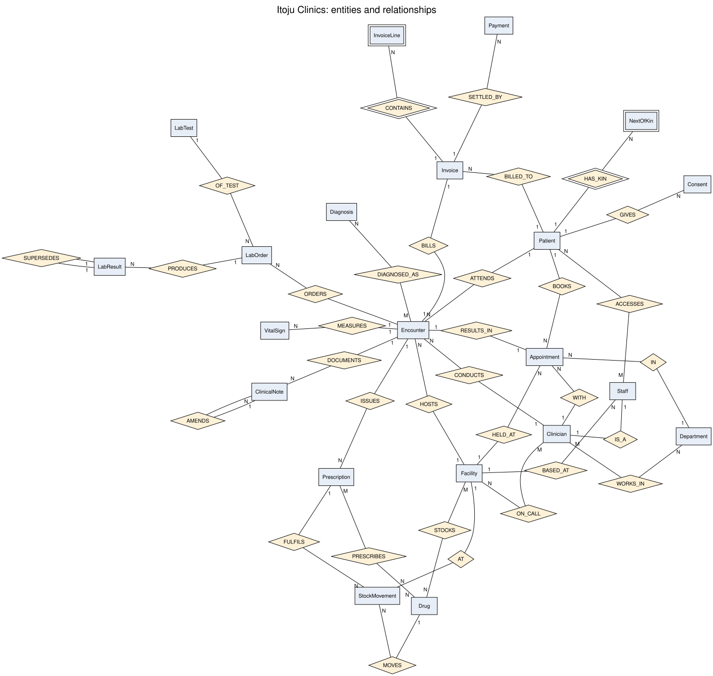

# Portfolio 1: Database Design and Modelling

The relational database at the centre of Itoju Clinics, taken from the organisation's requirements through a Chen ER model and a normalised relational schema to a PostgreSQL 16 build whose rules are enforced, and tested, in the database itself.



## Required evidence

- [x] Case study description: [the organisation](../README.md#the-organisation) and [requirements](design/requirements.md)
- [x] ER diagram: [overview](design/er-overview.svg), with attributes in [patients, staff and care](design/er-patient-care.svg), [pharmacy, stock and laboratory](design/er-pharmacy-lab.svg) and [billing, record access and on-call rota](design/er-billing-audit.svg)
- [x] Relational schema: [relational-schema.md](design/relational-schema.md#relations) and the build in [db/](db/)
- [x] Keys: [keys and constraints](design/relational-schema.md#keys-and-constraints)
- [x] Constraints: [keys and constraints](design/relational-schema.md#keys-and-constraints), tested in [p1-test-constraints.txt](outputs/p1-test-constraints.txt)
- [x] Normalisation explanation: [normalisation.md](design/normalisation.md), proved in [p1-normalisation.txt](outputs/p1-normalisation.txt)
- [x] Screenshots: [the stack running](outputs/screenshots/p1-01-stack-healthy.png), [69 of 69 constraint tests passing](outputs/screenshots/p1-03-constraint-tests.png), [a double booking refused](outputs/screenshots/p1-04-double-booking-refused.png) and [the catalogue check](outputs/screenshots/p1-05-catalogue-check.png)

## How I designed it

I followed the stages of database design in order, and each stage has its own artefact.

| Stage | What I did | Where |
|---|---|---|
| Requirements analysis | Identified the users and what each may see and do, listed the data, and wrote 20 testable business rules, 16 functional and 6 non-functional requirements | [requirements.md](design/requirements.md) |
| Conceptual design | Modelled 21 entities (two of them weak) and 33 relationships in Chen notation, with composite, multi-valued and derived attributes and 1:1, 1:N and M:N relationships | [er_model.py](design/er_model.py) and the four diagrams |
| Logical design | Mapped the model to 37 relations, chose keys and named every constraint after the rule it enforces, and normalised the old visit report to BCNF | [relational-schema.md](design/relational-schema.md), [normalisation.md](design/normalisation.md) |
| Physical design | Chose PostgreSQL 16, wrote the DDL, enforced cross-row rules with triggers and routines, set up nine least-privilege roles and the de-identified views | [db/](db/) |
| Testing and evaluation | Tested every constraint, routine and role, checked the data's consistency, proved the decomposition lossless and compared the live catalogue with the documentation | [tests/](tests/), [outputs/](outputs/) |

The ER diagrams are generated from a single model definition in [`design/er_model.py`](design/er_model.py), so the four views cannot disagree with one another. They use Chen's notation (Chen, 1976): entities are rectangles (double for weak entities), relationships are diamonds (double for identifying relationships), attributes are ellipses, keys are underlined (a weak entity's partial key too), multi-valued attributes have a double outline, derived attributes are dashed, and composite attributes branch into their parts. Cardinalities are written at the entity end of each line.

## The schema in brief

There are 37 relations: 30 for the organisation's data, six code tables and the private pseudonym key. Between them they carry 37 primary keys, 64 foreign keys, 23 unique constraints, 54 check constraints, 2 exclusion constraints, 4 partial unique indexes and 16 triggers ([summary](design/relational-schema.md#catalogue-summary)). The rules that carry the most weight for the clinic:

- **No double booking.** `EXCLUDE USING gist (clinician_id WITH =, slot WITH &&)` makes it impossible to store two overlapping active appointments for one clinician; a second exclusion constraint does the same for patients. Cancelled appointments are excluded from the check, so cancelling frees the slot.
- **Stock as a ledger.** Every receipt, dispense, transfer and adjustment is an append-only row in `stock_movement`. A trigger applies each one to the cached `stock_on_hand`, a check stops it going below zero, and a guard trigger refuses any other way of changing it.
- **Clinical records that cannot be rewritten.** Notes, lab results, payments, the status history and the access log refuse `UPDATE` and `DELETE`; corrections are new rows pointing at what they correct.
- **Money that balances.** Amounts are integer kobo. A deferred constraint trigger checks at commit that each invoice total equals its lines, and a payment can never exceed what is outstanding.
- **Privacy by design.** Identity data lives apart from clinical data. Clinicians read a patient's history only through `patient_record`, which logs who opened it, when, why and as which database user. Analysts see only pseudonymised views.

## How I implemented it

The build is six SQL scripts run in order by [`db/rebuild.sql`](db/rebuild.sql), inside one transaction, so a failed build leaves the previous database untouched:

| Script | Contents |
|---|---|
| [V01__extensions_roles.sql](db/V01__extensions_roles.sql) | `btree_gist`, the nine group roles (created only if missing) and a fresh `itoju` schema owned by `itoju_owner` |
| [V02__tables.sql](db/V02__tables.sql) | All 37 tables with their named keys and constraints |
| [V03__integrity.sql](db/V03__integrity.sql) | Trigger functions and triggers: append-only rules, the stock ledger, status history, the deferred transfer and invoice checks, payment and laboratory rules |
| [V04__routines.sql](db/V04__routines.sql) | The `SECURITY DEFINER` routines for registration, booking, dispensing, transfers, results, audited record access and the on-call rota |
| [V05__privileges.sql](db/V05__privileges.sql) | The patient directory and de-identified views, and every grant |
| [V06__sample_data.sql](db/V06__sample_data.sql) | A small, readable dataset: 12 branches, 24 staff, 12 patients, 12 appointments, 7 encounters with notes, prescriptions, lab results and invoices, and 83 stock movements |

Everything is created by `itoju_owner`, not the superuser, so ownership and privileges behave as they would in production. The sample data goes through the same triggers as real work: the stock levels, status history and invoice totals in it were produced by the rules, not typed in. The volume data used for performance work is generated separately in Portfolio 2.

Rules that span rows or tables cannot be plain check constraints, so I chose the narrowest tool for each. A composite foreign key keeps an encounter with its own appointment's patient. A deferred constraint trigger handles the rules that only make sense at commit (a transfer's two legs, an invoice's total). A routine handles the one rule about a set of rows, that someone stays on call. Every trigger and routine raises its error with a rule name, so a refusal always says which rule refused it.

## How I tested it

Each test runs inside a subtransaction that is always rolled back, so tests cannot affect one another, and records which named constraint, trigger rule or error stopped the operation, compared with the one I expected. A test that should succeed must complete without any error. Every suite ends with a summary row and exits non-zero if anything fails, and [`run_p1.py`](run_p1.py) stops at the first failing step.

| Suite | What it covers | Result | Evidence |
|---|---|---|---|
| Build | Rebuild from empty, row counts and constraint counts per table | completed | [p1-build.txt](outputs/p1-build.txt) |
| Constraints | Every rule, with valid and invalid rows: keys, checks, exclusions, append-only tables, the ledger, deferred checks | 69 of 69 passed | [p1-test-constraints.txt](outputs/p1-test-constraints.txt) |
| Routines | Normal and failure paths of every routine, including idempotent booking, statement atomicity and the audit row | 28 of 28 passed | [p1-test-routines.txt](outputs/p1-test-routines.txt) |
| Privileges | Allowed and refused actions for every role, run with `SET ROLE`; no `PUBLIC` execute; pinned `search_path`; no identifiers in de-identified views | 45 of 45 passed | [p1-test-privileges.txt](outputs/p1-test-privileges.txt) |
| Consistency | Stock equals the ledger and never went negative when the ledger is replayed in time order, invoices balance, no overlapping bookings, history matches status, and 10 more data rules | 15 of 15 passed | [p1-test-consistency.txt](outputs/p1-test-consistency.txt) |
| Normalisation | Functional dependencies, keys and lossless join tested on the data | 7 dependencies hold, 9 keys hold, 4 joins lossless | [p1-normalisation.txt](outputs/p1-normalisation.txt) |
| Catalogue | Live tables, columns in order, constraint counts, roles and views compared with [relational-schema.md](design/relational-schema.md) | 37 relations, 0 mismatches | [p1-catalogue-check.txt](outputs/p1-catalogue-check.txt) |

I also checked that the catalogue check can fail: with one column removed from a copy of the document, it reported the `drug` relation as different and exited with code 1.

To reproduce everything from an empty database:

```powershell
docker compose up -d --wait
.venv\Scripts\python portfolio-1-database-design\run_p1.py
.venv\Scripts\python portfolio-1-database-design\design\er_model.py   # redraws the ER diagrams (needs Graphviz)
```

## Design decisions

- **Surrogate keys, with natural keys kept unique.** Identity columns keep joins narrow and survive corrections to a hospital number or drug code; the natural keys stay unique because they are what staff search by.
- **Codes in tables, not check lists.** New statuses or payment methods are data changes, and behaviour such as a movement's direction lives with its code.
- **Exclusion constraints for bookings, not application checks.** A check-then-insert in application code can race; the exclusion constraint cannot, whatever the isolation level. Portfolio 3 shows the race it prevents.
- **A ledger plus a cached total.** The ledger explains every unit of stock; the cached total makes dispensing and reorder checks cheap. The two are reconciled on every build.
- **Rules raised by name.** Naming every rule, including those enforced by triggers and routines, made the tests precise: each one asserts which rule refused it, not merely that something failed.
- **Definer-rights views for restricted roles.** Analysts and receptionists have no access to base tables at all, so the views run with their owner's rights rather than the caller's.
- **No workload indexes yet.** Only the indexes that keys and exclusions need exist. Others are added in Portfolio 2 once the query plans show they are worth their cost.

## Contents

| Path | What it holds |
|---|---|
| [design/requirements.md](design/requirements.md) | Users, data dictionary, business rules, requirements and traceability |
| [design/er_model.py](design/er_model.py), `design/er-*.dot`, `.svg`, `.png` | The Chen ER model and its four diagrams |
| [design/relational-schema.md](design/relational-schema.md) | Mapping, conventions, relations, keys and constraints, views, roles, routines |
| [design/normalisation.md](design/normalisation.md) | From the visit report to BCNF, the lossless-join proof and the deliberate denormalisations |
| [db/](db/) | The build scripts |
| [tests/](tests/) | The test harness, the five SQL suites and the catalogue check |
| [run_p1.py](run_p1.py) | Rebuilds and tests everything, capturing the evidence |
| [outputs/](outputs/) | Evidence files, including the server environment captures |
