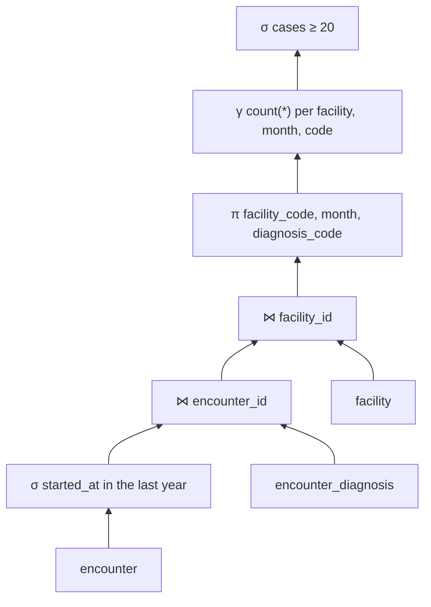

# Performance analysis

Every figure here comes from the evidence in [outputs/](outputs/) and the per-query plans in [plans/](plans/). Times are the median of five `EXPLAIN (ANALYZE, BUFFERS)` runs; buffers are the 8 kB pages one execution touched. The full table for all fifteen measurements is in [results/comparison.md](results/comparison.md).

## Before and after

| Query | Technique | Plan change | Median ms (baseline → indexed → tuned) | Buffers (baseline → final) | Same result |
|---|---|---|---|---|---|
| Q01 phone lookup | B+ tree on `patient_phone (phone_no)` | Seq Scan → Index Scan | 7.151 → 0.030 → 0.055 | 482 → 7 | yes |
| Q02 patient timeline | Multi-column index `(patient_id, started_at DESC)` | Parallel Seq Scan + Sort → Index Scan under Limit, no Sort | 37.382 → 0.240 → 0.628 | 8,921 → 227 | yes |
| Q03 / Q03b clinician's day | None: the exclusion constraint's partial GiST index | Q03 uses it; Q03b cannot | 0.167 / 157.628 at baseline | 62 / 13,699 | yes |
| Q05 monthly diagnoses | Materialised view `monthly_diagnosis` | Parallel aggregate over a year of encounters → Seq Scan of 4,800 rows | 1,031.987 → 1,257.514 → 7.403 | 13,847 → 35 | yes |
| Q06 reorder report | Partial covering index on dispenses, `INCLUDE (quantity)` | 17 sequential scans of the ledger → 17 Index Only Scans | 1,817.483 → 1.182 → 1.799 | 151,713 → 79 | yes |
| Q07 lab turnaround | Covering index on `lab_order (ordered_at)` | Parallel Seq Scan → Index Only Scan, but the plan turned serial | 70.047 → 80.079 → 121.654 | 4,466 → 2,197 | yes |
| Q08 no visit in a year | `NOT IN` → `NOT EXISTS` | Plain subplan, timed out at 120 s → Hash Right Anti Join | timeout → timeout → 204.052 | – → 5,924 | yes |
| Q09 frequent attenders | B+ tree on `encounter (started_at)` | Seq Scan → Index Scan of 30 days | 124.485 → 47.985 → 79.459 | 11,742 → 1,395 | yes |
| Q10 consultation length | Index on `encounter_type_code` offered | None: Parallel Seq Scan kept, index used 0 times | 345.031 → 175.705 → 196.024 | 8,818 → 8,927 | yes |
| Q12 / Q13 stock at Ikeja | Cached total against the ledger | Seq Scan of 144 rows against an aggregate of the ledger | 0.099 / 188.442 at baseline | 4 / 8,975 | yes |

## What the measurements show

PostgreSQL's optimiser is cost-based: it estimates, from the table statistics, the rows and pages each candidate plan would need and picks the cheapest. The indexes that worked turned a scan of the whole table into a visit to a handful of pages. A point lookup by phone went from 482 pages to 7 (Q01). The timeline index stores each patient's encounters already in date order, so the `Limit` stops after twenty entries and the Sort disappears (Q02, 8,921 pages to 108 when first indexed). The reorder report had been running a sequential scan of the 722,227-row ledger once for each of 17 low stock lines; the partial covering index holds only dispenses and carries the quantity, so each line became an Index Only Scan and the query fell from 1.8 seconds to about a millisecond (Q06).

Indexes did not always help. Two in three encounters are consultations, so reading them through `encounter_type_ix` would visit nearly every page at random; the optimiser kept the sequential scan and the index recorded zero scans while costing 4.9 MB and write overhead (Q10). The exclusion constraint's GiST index served the active schedule in 62 pages, but the same query without `appointment_status_code <> 'CANCELLED'` could not use it, because a partial index is only usable when the query's condition implies the index's own (Q03b, 13,699 pages). Q07 is the instructive failure: its covering index halved the pages read and removed every heap visit to `lab_order`, but the cheaper plan fell below the cost at which PostgreSQL starts parallel workers, so the remaining scan of `lab_result` ran on one process and the query got slower. A plan's cost estimates work, not wall time.

Rewriting mattered more than indexing for Q08. `NOT IN` must return nothing if the subquery yields a NULL, so PostgreSQL cannot turn it into an anti-join; with the 350,778-row subquery too big to hash in the default 4 MB `work_mem`, it rescanned the list for each patient and hit the 120-second limit. `NOT EXISTS` became a hash anti-join in about 200 ms. Raising `work_mem` to 64 MB let `NOT IN` hash its subquery too (Q08b, 186 ms); both return the same 8,583 patients.

Estimates were least reliable where the data is skewed. The default sample estimated 30,752 distinct patients among encounters against 57,938 actually there; a statistics target of 1,000 raised that to 50,609, or 87%. It cannot rescue Q02's estimate for its busiest patient, because the patient is found through a subquery and the planner, not knowing who it will be, assumes an average patient. `HAVING` filters are guessed outright, which is why Q05 and Q09 overestimate their output 80-fold and about 28-fold. Every measured plan was nevertheless stable across its five runs.

Reads were bought with writes and space. The six indexes added 82 MB to the 562 MB of indexes the keys already needed. Over 2,000-row batches, inserting encounters, which now maintain three extra indexes, slowed by 51%; the other three changes were within the run-to-run noise of this laptop, where even an identical plan's median moved by half (Q10). For that reason I compare buffers first and treat times as supporting figures. The materialised view brought the monthly report from about a second to 7 ms, at the price of data only as fresh as its last refresh, which took 6.2 seconds, or 9.2 seconds concurrently so that readers are not blocked. Finally, the cached stock totals earned their place in the design: Q12 reads Ikeja's stock from 4 pages, while recomputing the same twelve numbers from the ledger touches about 9,000 (Q13).

## Q05 as relational algebra

The monthly report, with γ for grouping:

σcases ≥ 20 ( γfacility_code, month, diagnosis_code; count(\*) → cases ( πfacility_code, started_at, diagnosis_code ( ( σ2025-11-01 ≤ started_at < 2026-11-01(encounter) ⋈encounter_id encounter_diagnosis ) ⋈facility_id facility ) ) )

The selection on `started_at` is pushed down to `encounter`, below the joins, so only a year of encounters is joined. The optimiser then chose hash joins and a parallel partial aggregate, and could do nothing about the final σ on `cases`, which can only be applied after counting. The materialised view moves the expensive lower part of this tree out of the query altogether.
