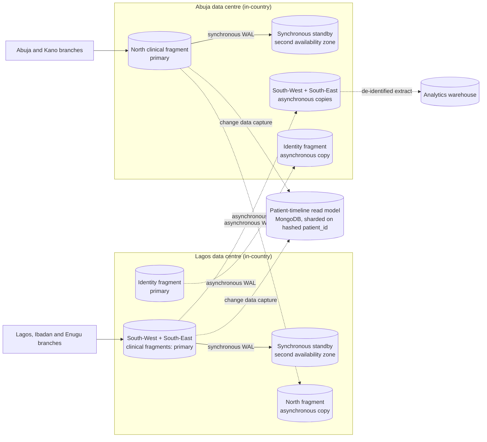

# Distributing Itoju Clinics

Itoju Clinics runs twelve branches in five cities from one PostgreSQL database. That is simple and correct while every branch can reach it, but a lost link between Abuja and Lagos would stop Kano's front desk booking anyone. This design keeps each region working on its own, keeps identity data apart from clinical data as the Nigeria Data Protection Act 2023 expects for health records, and keeps every copy in Nigeria. I tested the parts a single machine can test with two working setups: PostgreSQL streaming replication with failover ([p5-01](outputs/p5-01-pg-replication.txt)) and a sharded MongoDB cluster ([p5-02](outputs/p5-02-mongo-sharding.txt)).

## Fragmentation

**Horizontal, by region.** Clinical rows (encounters, prescriptions, lab orders, stock movements, invoices) are fragmented by the region of the branch that created them:

- South-West: the four Lagos branches and the two in Ibadan
- North: the three in Abuja and the one in Kano
- South-East: the two in Enugu

Each fragment is a selection, such as `encounter_north = σ region = 'North' (encounter)`. Every row belongs to one branch and every branch to one region, so the fragments are **complete** and **disjoint**, and their union **reconstructs** the relation.

**Vertical, identity from clinical.** Names, phone numbers, addresses and national IDs form an identity fragment; clinical fragments carry only `patient_id` and the pseudonymous key. Both keep `patient_id`, so the join that reconstructs a patient's record is lossless, as in [Portfolio 1](../portfolio-1-database-design/design/normalisation.md). This is privacy by design: a breach of a clinical copy exposes no names, and access to identity can be logged and restricted separately. The scheme is hybrid, vertical then horizontal.

## Allocation and replication

Two in-country data centres, in Lagos and Abuja, hold the primaries for their own regions, so every branch writes within its region; the small South-East fragment is served from Lagos. Each primary has a **synchronous** standby in a second availability zone of the same city, and **asynchronous** copies of every fragment go to the other city for disaster recovery and reporting. Replication is therefore full across the two cities, since each holds every fragment, but synchronous only for a city's own fragments.

On one host, the median commit took 1.734 ms with `synchronous_commit = off`, 3.600 ms with `local`, 4.033 ms with `on` (waiting for the standby to flush) and 4.375 ms with `remote_apply`. Between Lagos and Abuja, every booking and every dispense would add a network round trip of several hundred kilometres, which is why synchronous replication stops at the city boundary.

## Consistency for each kind of data

| Data | Consistency | How |
|---|---|---|
| Bookings, stock, payments | Strong | Acknowledged only once the synchronous standby has the WAL; none of 1,008 acknowledged writes was lost on failover |
| A clinician's own entries | Read-your-writes | Reads after a write go to the primary; with replay paused, a booking just made was missing from the asynchronous replica (0 rows) |
| Reporting and analytics | Eventual | Read from asynchronous copies, which may be seconds behind |
| Patient-timeline read model | Eventual | Fed one way from the primaries by change data capture |

## Availability, CAP and PACELC

Within a region the system chooses consistency. With the synchronous standby stopped, a commit on the primary waited (`wait_event SyncRep`) rather than return with only one copy. When cancelled, PostgreSQL warned that "the transaction has already committed locally, but might not have been replicated to the standby", so the application must treat that booking as uncertain and check before retrying. That is CP behaviour: no acknowledged write can be lost to a single failure.

During a partition between the cities, each region keeps serving its own branches from its local primary. A Kano patient's Lagos history can then only be read from Abuja's asynchronous copy, marked as possibly stale. In PACELC terms (Abadi, 2012), the system is PC/EC within a region and PA/EL across regions.

When the primary was killed while a client kept writing, the synchronous standby was promoted with `pg_promote()` and started timeline 00000002. The longest gap between two acknowledged writes was 2.61 s, including a one-second pause I left for the decision to fail over. The old primary cannot simply rejoin: its timeline has diverged and it may hold WAL the new primary never received, so it must be rewound with `pg_rewind` or rebuilt from a base backup. Automatic failover needs a manager such as Patroni with a consensus store, so that two primaries never both accept writes.

## Sharding

For the relational system of record, the shard key is the region. That is low cardinality on purpose: it keeps data next to the branches that write it. Its risk is a hot spot, because Ikeja alone created 135,749 of the 714,247 encounters. If the South-West shard outgrows one primary, Lagos becomes its own shard.

For the patient-timeline read model, the key is a **hashed `patient_id`**: high cardinality, and the field every timeline query filters on. In the MongoDB cluster, 102,035 encounters split 50,576 to 51,459 across two shards. A patient's timeline went to one shard (`SINGLE_SHARD`), while a query for one branch's visits went to both and was merged (`SHARD_MERGE`). With a ranged key on `created_at` instead, all 5,000 new visits went to the shard holding the newest range and none to the other, while the hashed key shared them 2,493 to 2,507. A monotonically increasing key makes one shard the bottleneck for every new write.

A stock transfer from Lagos to Abuja crosses shards. Two-phase commit would hold both stock rows locked while waiting on a link that might fail, so I would model it as a saga: a committed `TRANSFER_OUT` in Lagos, then a committed `TRANSFER_IN` in Abuja on receipt, with a compensating adjustment if the consignment is lost. Within a region a transfer stays one ACID transaction, as in [Portfolio 3](../portfolio-3-transactions-concurrency/concurrency.md).

A failed shard takes only its own data with it. With one MongoDB shard stopped, a patient on the healthy shard was still readable, a count of every encounter failed ("Could not find host matching read preference … for set shard_b"), and `allowPartialResults` returned the healthy shard's 53,069 documents.

## Architecture and transparency

The design is client-server: applications reach their region's database through a connection router. The system of record is homogeneous, PostgreSQL 16 throughout, with MongoDB as a separate read model. I rejected peer-to-peer multi-primary replication, because two primaries accepting writes to the same stock or the same clinician's diary would create exactly the conflicts that Portfolio 1's constraints prevent. I rejected a federation of independent branch databases because it gives up cross-branch integrity.

The router provides **location** and **replication transparency**: applications ask for a branch, not a server, and reads may go to a replica unless they need their own writes. **Fragmentation transparency** is partial, because the router must know which region a branch belongs to. **Transaction transparency** holds within a region and is given up across regions, where the saga is explicit.

## Cloud deployment and the law

Health data is sensitive personal data under the Nigeria Data Protection Act 2023, which restricts transfers abroad, so every copy stays in Nigeria. The deployment is a hybrid cloud: the identity fragment on servers Itoju controls in both data centres (private), and the clinical fragments on a managed PostgreSQL service (DBaaS) hosted in-country, or self-managed PostgreSQL with a Nigerian provider. Only de-identified extracts reach the analytics warehouse. Data is encrypted in transit with TLS and at rest, backups included, with keys held by Itoju rather than the provider. Continuous WAL archiving and base backups allow point-in-time recovery. The recovery point objective is zero for a single-zone failure, because of the synchronous standby, and seconds of replication lag for the loss of a city. The recovery time objective is the time to promote: 2.61 s in the test, and longer in practice once detection and fencing are included.

## What one machine cannot show

Both setups ran on one laptop, where stopping a container stood in for losing a server or a link. Nothing measured latency between cities, packet loss, a true network partition, or a server that is running but unreachable. Promotion was manual, with no Patroni, consensus store or fencing. Each MongoDB shard and the config server is a single member, so the cluster shows routing and partial availability but not a shard surviving the loss of a member. TLS, encryption at rest, backups and point-in-time recovery are designed but were not built.
